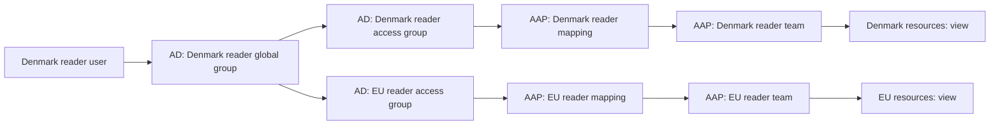

# Demonstrate AD groups mapped to AAP teams

For a short presentation with extra Windows instructions and fewer AAP details,
use the [five-minute walkthrough](active-directory-demo-quickstart.md).

This is a presenter walkthrough for someone who has not used Active Directory
(AD), LDAP or AAP authentication mappings before. Allow 15–20 minutes. It
uses VNC to view the domain controller and a browser to view the dedicated test
AAP. The demonstration reads the existing configuration and runs inert mock
jobs; it does not require editing directory membership or AAP permissions.

For your first presentation, use the Denmark reader walkthrough in sections
2–9. Section 10 adds optional role/region comparisons. The setup reference at
the end is preparation material, not something to walk through on stage.

## 1. Understand the story you are showing

Use this explanation at the start:

> “We maintain people and their regional group memberships in Active Directory.
> When someone signs in, AAP checks AD and puts them into the matching AAP teams.
> Those teams already have permissions on their region's automation resources.”

| Term | Meaning in this demo |
| --- | --- |
| AD | The Windows directory that holds users and groups. |
| Domain controller | The separate Windows Server 2025 VM running AD. |
| LDAP | The protocol AAP uses to find and authenticate directory users and read their groups. |
| LDAPS | LDAP protected by TLS; this demo uses port 636 and certificate verification. |
| AD group | A collection of users, or other groups, maintained in AD. |
| AAP team | A collection of AAP users with assigned AAP resource permissions. |
| Mapping | A rule saying “membership in this AD group gives membership in this AAP team.” |
| OU | An organizational unit: a folder-like container inside AD. |
| DN | A distinguished name: an object's full directory address, including its containers. |

The relationship you will trace is:

AD supplies identity and group membership. Ansible configures the AAP mappings,
teams and permissions. AAP does not import Windows file permissions or other AD
ACLs as permissions on job templates, credentials or inventories.

If someone asks **“Are the permissions in AD too?”**, answer:

> “AD holds the role groups and who belongs to them. AAP holds the permissions
> on its inventories, credentials and job templates. Our Ansible configuration
> connects those two: changing a person's AD group changes which AAP team's
> permissions they receive when they authenticate.”

For example, Denmark executor group membership maps to the Denmark executor
and EU executor teams, whose AAP grants permit execution of their regional jobs
and use of their inventories and credentials. The words `reader`, `executor`
and `admin` in an AD group name do not create resource permissions by themselves.
This is the documented AD-controlled entitlement pattern: directory groups
select the user's AAP teams, whose resource roles supply the effective access.
The normal group mapping requires no custom permission-policy translator.

## 2. Prepare your screens and demo accounts

1. Open VNC to the **AD domain controller**, rather than a WSUS or application
   server. Sign in with the protected domain administrator credentials.
2. Open the **dedicated test AAP** in a browser. Sign in as its local AAP
   administrator. Keep this window open throughout the demonstration.
3. Prepare a separate private/incognito browser window for an AD test user.
   This keeps the administrator and test-user sessions separate.
4. Obtain the Denmark reader account and its password from the protected demo
   configuration before presenting. Also prepare Denmark executor, Denmark
   admin and New Zealand reader if you want to show all contrasts below.
5. Check that the regional project has synced and that **Verify AD AAP Access**
   has a successful run with `ad_verify_ldap_logins: true`. A run without that
   option verifies configured grants, not actual AD login and effective access.
   See [validation status](#12-validation-status-and-rehearsal-checks) for the
   completed checks and remaining rehearsal limits.

This guide uses `<prefix>` for the deployment's chosen identity prefix. Replace
it with the prefix visible in your existing groups and AAP teams. Names below
are patterns, not additional objects to create. The generated account pattern
is `<prefix-lowercase>-<region-lowercase>-<role>`, using region codes `dk`, `no`,
`eu` and `nz`.

The protected profile is `vars/active_directory_vault.yml`. The corresponding
`active_directory.users` entries contain `username`, `password`, `region` and
`role`. Retrieve these privately using the existing Vault password source. Do
not project the decrypted profile or reset passwords for the presentation.

## 3. On Windows: find the Denmark reader in AD

1. In the domain controller's VNC window, open **Server Manager**.
2. Select **Tools → Active Directory Users and Computers**. As an alternative,
   press **Win+R**, enter `dsa.msc`, and press Enter.
3. Expand the domain in the left pane.
4. Expand the OU named after `<prefix>`, then select its **DK** OU.
5. Locate the Denmark reader user. Its generated account name ends in
   `-dk-reader`. Double-click it to open **Properties**.
6. Open **Account** and point out **User logon name (pre-Windows 2000)**. That
   short account name is the username to enter into AAP.
7. Open **Member Of**. Locate `<prefix>-GG-DK-reader`.

Expected: the user is directly in its Denmark reader global group. The standard
**Domain Users** membership may also appear. The EU access group need not appear
in this user dialog: **Member Of shows direct memberships, not the full nested
membership chain**.

Say:

> “This is our Denmark read-only identity. Its regional membership is defined
> here in AD. Next we will follow that group to the access groups AAP reads.”

Close the user properties without saving changes.

## 4. On Windows: show why Denmark also receives EU access

`GG` means **global group**, which holds the regional users. `DL` means
**domain-local group**, which is the access group used by the AAP mapping.
You do not need to explain Windows group-scope rules in depth during the demo.

1. In the **DK** OU, double-click `<prefix>-GG-DK-reader`.
2. Open **Members**. Show that the Denmark reader user belongs to this group.
3. Open **Member Of**. Show these two parent access groups:

   - `<prefix>-DL-DK-reader`
   - `<prefix>-DL-EU-reader`

4. Close the properties window. Select the **EU** OU.
5. Open `<prefix>-DL-EU-reader`, then its **Members** tab.
6. Show that its members are the global reader groups for **DK**, **NO** and
   **EU**. The New Zealand global reader group is absent.

Say:

> “Denmark and Norway readers inherit EU reader access through group nesting.
> They do not inherit each other's country access. New Zealand is separate.”

The same nesting applies separately to executor and admin. Reader membership
does not turn into executor or admin membership.

## 5. In AAP: show the LDAP connection

Return to the browser window signed in as the AAP administrator.

1. Navigate to **Access Management → Authentication Methods**.
2. Open **`<prefix> Active Directory`**.
3. On its details page, point out that it is enabled and uses **LDAP**.
4. Show that the LDAP server URI starts with `ldaps://` and uses port **636**.
5. Show **LDAP Group Type: NestedActiveDirectoryGroupType**. This is what lets
   AAP follow the group nesting you just showed on Windows.
6. If configuration details require opening **Edit**, inspect them without
   changing anything, then leave with **Cancel**. Keep secret fields masked.

Say:

> “AAP asks this directory to authenticate the user and resolve their groups.
> The connection is encrypted, and AAP follows nested memberships.”

There is no separate Windows domain join of the existing demo servers involved
in this login demonstration.

## 6. In AAP: show the actual AD-to-team rules

1. In the same authentication method, select the **Mapping** tab.
2. Open **DK reader membership**. If the UI only exposes its fields in an edit
   form, inspect that form and leave without saving.
3. Point out these values:

   | Mapping field | Expected value |
   | --- | --- |
   | Mapping type | Team |
   | Organization | `<prefix> Regional Identity Demo` |
   | Team | `<prefix> Denmark reader` |
   | Role | Team Member |
   | Group trigger | The full DN of `<prefix>-DL-DK-reader`, stored in lowercase |
   | Revoke | Enabled |

4. Explain that the long group value is the AD group's address, not a second
   AAP team name. It identifies the access group shown on Windows.
5. Return to the mapping list and open **EU reader membership**. Show that it
   targets `<prefix> EU reader` and matches the EU reader access group's DN.
6. Point out that there are twelve team rules: four regions times three roles.
   The separate **Regional demo login** and **Regional demo organization** rules
   admit eligible identities and give them organization membership.

To show the same full address on Windows, select **View → Advanced Features**
in Active Directory Users and Computers. In the **DK** OU, open
`<prefix>-DL-DK-reader` directly, select **Attribute Editor**, locate
**distinguishedName**, and inspect its full value. Compare it with the AAP trigger;
letter case differs because the trigger is normalized to lowercase. Close
the dialogs without changing the attribute.

Say:

> “This is the bridge between the two systems: membership in this AD access
> group becomes membership in this AAP team when the user authenticates.”

The mapping's **Team Member** role means membership of the AAP team. It is not
the reader/executor/admin resource role. The team name describes its purpose;
its separate resource assignments enforce that purpose.

## 7. In AAP: show what the reader team is permitted to do

1. Navigate to **Access Management → Teams**.
2. Search for and open `<prefix> Denmark reader`.
3. Open the **Roles** tab and inspect its resource assignments. If the UI offers
   a service filter, select **Automation Execution**.
4. Show the four assignments: its Denmark mock inventory, Denmark mock
   credential and the two Denmark mock job templates.
5. Point out the custom reader roles. They contain view permissions only.
6. Open `<prefix> EU reader` and show the corresponding EU assignments.

Say:

> “AD determines which team the person joins. These AAP assignments determine
> what that team can see and do. The grants are scoped to particular resources.”

All regions have one inventory, one synthetic credential and two inert job
templates, named `read` and `simulate_change`. A credential reader can view its
metadata; this does not reveal its stored password.

## 8. Log in as the AD user and show the membership result

1. In the private browser window, open the same test AAP URL.
2. Sign in with the **Denmark reader's AD username and password**, not the
   local AAP administrator account. Use the short account name found in step 3.
3. Confirm that the signed-in identity is the Denmark reader.
4. Return to the administrator window. Navigate to **Access Management → Users**,
   find that exact account, and open its **Teams** tab.
5. Show that the user belongs to exactly the two regional teams:

   - `<prefix> Denmark reader`
   - `<prefix> EU reader`

6. Alternatively, open each of those teams and its **Users** tab to show the
   same membership from the team's perspective.

Say:

> “We signed in with an AD identity. The mapping put it in the Denmark reader
> and EU reader teams, following the memberships we saw in AD.”

The account may already exist in AAP because rehearsal or automated verification
has logged it in. Do not claim that you just created it. The evidence is the
matching AD group chain, mapping rules, authenticated identity and team result.
The teams themselves were created by Ansible before user login; their existence
alone is not evidence that LDAP mapping works.

## 9. As the reader: demonstrate the access boundaries

Perform these actions in the **private reader window**, not the administrator
window.

1. Open **Automation Execution → Infrastructure → Inventories**. Search for the
   demo prefix if necessary. Show the **Denmark** and **EU** mock inventories.
2. Show that **Norway** and **New Zealand** mock inventories are absent.
3. Open **Automation Execution → Templates**. Show the Denmark and EU mock
   templates. As a reader, the user must not be able to launch them.
4. Open **Automation Execution → Infrastructure → Credentials**. Show Denmark
   and EU mock credential metadata, without attempting to reveal secrets.
5. Point out that editing these resources is unavailable to the reader. The
   browser may hide forbidden actions instead of displaying an error dialog.

Say:

> “This person can inspect Denmark and EU automation. They cannot run jobs,
> change the configuration, or see the other regions' resources.”

If your UI navigation is collapsed, expand **Automation Execution** first.
Labels and button placement can vary with the installed UI build; the object
names and access outcomes above are the checks that matter.

## 10. Show executor, admin and New Zealand contrasts

Sign out of the private window between accounts; keep the administrator window
unchanged. Use the same AD → mapping → team explanation for each identity.

| AD identity | Expected AAP teams | What to demonstrate |
| --- | --- | --- |
| Denmark executor | Denmark executor, EU executor | Open a Denmark `read` template, launch it, and wait for **Successful**. Show that it cannot edit the inventory configuration. |
| Denmark admin | Denmark admin, EU admin | Open an allowed regional resource and show that **Edit** is available; leave with **Cancel**. This is resource administration, not platform administrator access. |
| Norway reader | Norway reader, EU reader | Norway and EU visible; Denmark and New Zealand absent. |
| EU reader | EU reader only | EU visible; neither country nor New Zealand inherited. |
| New Zealand reader | New Zealand reader only | New Zealand visible; EU, Denmark and Norway absent. |

The `read` and `simulate_change` templates run
[`mock_regional_job.yml`](../mock_regional_job.yml). Both are demonstrations
against a local mock host, with fixed regional inputs and synthetic credentials.
They do not patch a server or make an infrastructure change. Inspect the job's
output and final status rather than stopping at “launch accepted.”

Describe New Zealand as an **external region with separate access in this demo**.
Its identities live in the same demonstration AD forest. No separate forest,
trust relationship or automatic EU entitlement has been deployed.

## 11. Close with the automation evidence

1. In the administrator window, find the template ending **Verify AD AAP
   Access**. Open a successful run whose inputs enable `ad_verify_ldap_logins`.
2. Show the final **Report non-sensitive verification counts** output.
3. Explain the expected completed result: **4 regions, 12 teams, 48 scoped team
   grants, 12 real LDAP logins, 192 regional access/launch checks and 12 completed
   mock jobs**. Forbidden cross-region access must fail, rather than being skipped.
4. If desired, show the deployment workflow's eight AD stages. Explain that
   Ansible created the directory, trust, identities, maps and permissions.
   Opening the workflow does not require launching it.

Suggested closing words:

> “The identity administrator manages regional membership in AD. On login, AAP
> maps those groups to teams. Ansible maintains the teams' scoped automation
> permissions and verifies both permitted and forbidden access.”

## 12. Validation status and rehearsal checks

The complete live verifier passed: **4 regions, 12 teams, 48 scoped grants,
12 real LDAP logins, 192 regional access/launch checks and 12 successful mock
jobs**. Independent reads also verified every account's expected teams on both
gateway and controller, including matching-role EU inheritance for Denmark and
Norway and separate New Zealand membership. Denmark reader's inventory reads
allowed Denmark/EU and denied Norway/New Zealand.

Earlier runs stopped at first-login controller access for Norway identities.
Inspection found a gateway identity and correct memberships before a controller
account had been provisioned. The verifier now reads each user's own identity
on both services before checking permissions, then retains its bounded wait for
expected access. No permission grants were broadened during diagnosis.

The automated checks do not establish that this VNC/browser presenter script
has been rehearsed end to end, or that the complete combined infrastructure
workflow has been run from scratch. Rehearse the selected accounts and screens
before presenting.

| Symptom | Check before presenting |
| --- | --- |
| No AD console in VNC | Confirm that this is the domain controller. The deployment installs AD management tools; try `dsa.msc`. |
| Cannot find groups | Expand the prefix OU and its DK/NO/EU/NZ OUs. The access group may be in EU, rather than the user's country OU. |
| EU absent in a user's AD Member Of tab | Inspect the user's global group's **Member Of** or the EU access group's **Members**; nested membership is not listed as direct membership on the user. |
| LDAP login fails | Check the selected test AAP, exact short username, enabled authenticator, domain time, DNS, LDAPS certificate and gateway trust. Use the existing inspection and trust templates. |
| Login works but teams are missing | Inspect both relevant mapping rules, their full lowercase group DNs and the nested group type. Reauthenticate after configuration or membership changes. |
| Teams are present but a resource is missing | Inspect that team's resource Roles in the administrator window and gateway/controller convergence. Run the verifier; do not add broad roles to make the demo pass. |
| Reader can launch, or another region is visible | Stop that part of the demonstration and investigate the permission failure. This is not an expected outcome. |
| An old authenticated session still has access | Mapping is evaluated during authentication; refreshing a page alone is not a membership-revocation test. |

A live removal-and-restoration demonstration has not been validated. This
walkthrough therefore uses the deployed membership chain and actual login
results. Reconcile desired changes through Ansible before rehearsing a separate
revocation demonstration; do not improvise directory edits during this one.

## 13. Setup reference for the existing Ansible automation

This section is for preparing the demo, rather than narration during it.
Environment-specific accounts, addresses, keys and passwords remain in Vault or
protected AAP credentials, not this guide.

1. Use the existing Server 2025 image, hypervisor inventory and an execution
   environment compatible with the pinned
   [`collections/requirements.yml`](../collections/requirements.yml). Keep a
   separate one-host Windows inventory for the new domain controller; its
   management connection is WinRM HTTPS on port 5986.
2. Reuse the approved encrypted `vars/active_directory_vault.yml` for this
   deployment. For a genuinely new environment,
   [`initialize_active_directory_profile.yml`](../initialize_active_directory_profile.yml)
   generates users, group nesting, passwords and dedicated LDAPS PKI from a
   protected `ad_profile_seed`, `ad_profile_encrypted_output` and
   `ad_profile_vault_password_file`. It refuses an existing output. Preserve the
   resulting profile and matching private backup rather than regenerating them
   on reruns.
3. Populate the **Windows AD AAP Target** credential for the selected test AAP.
   It contains the target URL, administrator password, trusted public CA bundle,
   SSH account/password, previously verified SSH host keys and installation
   service account. The CA is injected as a private file. Attach that credential
   and the playbook Vault credential to target-configuration stages. Attach the
   hypervisor SSH plus Vault credentials to hypervisor stages, and Windows
   machine plus Vault credentials to Windows stages.
4. For a fresh environment, use the AD branch in the existing Windows workflow,
   in the order shown below. Existing Windows nodes are preserved. The encrypted
   Windows CaC repository includes this branch and its target credential
   definition; the AutoDeploy Windows importer populates the credential for the
   receiving AAP. Importing definitions does not run the deployment or enable LDAP.

   | Order | Template suffix | Playbook | Required result |
   | --- | --- | --- | --- |
   | 1 | Reserve AD Address | [`configure_active_directory_address.yml`](../configure_active_directory_address.yml) | Unambiguous DHCP reservation and matching LDAPS DNS name, with `ad_address_reservation_before_create: true`. |
   | 2 | Create AD VM | [`create_active_directory_vm.yml`](../create_active_directory_vm.yml) | A new, independent Server 2025 VM; an existing VM/disk is refused. |
   | 3 | Prepare and Update AD Guest | [`prepare_active_directory_guest.yml`](../prepare_active_directory_guest.yml) | `ad_direct_microsoft_updates_approved: true`; zero remaining applicable Server updates and no pending reboot. |
   | 4 | Deploy Active Directory | [`deploy_active_directory.yml`](../deploy_active_directory.yml) | AD DS/DNS ready, synchronized domain clock, 12 users and 24 role groups with verified nesting. |
   | 5 | Configure AD LDAPS | [`configure_active_directory_ldaps.yml`](../configure_active_directory_ldaps.yml) | Correct certificate, hostname/chain verification and completed required restart. |
   | 6 | Configure AD Gateway Trust | [`configure_aap_ad_trust.yml`](../configure_aap_ad_trust.yml) | `ad_trust_verify_ldaps: true` and `ad_require_target_credential: true`; actual gateway-runtime LDAPS validation passes. |
   | 7 | Configure AD AAP Regions | [`configure_aap_ad_regions.yml`](../configure_aap_ad_regions.yml) | `ad_aap_configure_authentication: true` and `ad_require_target_credential: true`; all scoped resources and ordered LDAP maps configured. |
   | 8 | Verify AD AAP Access | [`verify_aap_ad_regions.yml`](../verify_aap_ad_regions.yml) | `ad_verify_ldap_logins: true` and `ad_require_target_credential: true`; full positive/negative access verification passes. |

5. The trust stages publish `ad_ldaps_ready` and `ad_gateway_trust_ready` for
   later workflow stages. When retrying LDAP configuration separately, supply
   these readiness flags only after checking successful trust results. If the
   resources already exist, `ad_aap_authentication_only: true` verifies all 48
   existing grants before resuming authentication configuration.
6. For an existing deployment, retry the individual failed stage. Do not launch
   fresh VM creation over the existing controller. The guest inspector is
   [`inspect_active_directory_guest.yml`](../inspect_active_directory_guest.yml);
   use `ad_inspect_domain_auth: true` after promotion.
7. Keep the encrypted profile backup in the private Windows CaC repository
   consistent with the profile loaded by the public playbooks. The capture's
   `cac` Vault identity and the playbook-profile Vault password are separate.

The Microsoft patch check reports the Windows 11-only KB5007651 Security UI
offer separately on Server 2025. It does not exclude applicable Server updates
or Defender antivirus updates. See the [README](../README.md#active-directory-extension)
for the product-applicability explanation and detailed recovery options.

## Reference: all twelve team mappings

Each row maps an access group to **Team Member** in the named AAP team. All
teams belong to `<prefix> Regional Identity Demo`. The actual trigger uses the
group's full lowercase DN, not just the short name in this table.

| AD access group | AAP team |
| --- | --- |
| `<prefix>-DL-DK-reader` | `<prefix> Denmark reader` |
| `<prefix>-DL-DK-executor` | `<prefix> Denmark executor` |
| `<prefix>-DL-DK-admin` | `<prefix> Denmark admin` |
| `<prefix>-DL-NO-reader` | `<prefix> Norway reader` |
| `<prefix>-DL-NO-executor` | `<prefix> Norway executor` |
| `<prefix>-DL-NO-admin` | `<prefix> Norway admin` |
| `<prefix>-DL-EU-reader` | `<prefix> EU reader` |
| `<prefix>-DL-EU-executor` | `<prefix> EU executor` |
| `<prefix>-DL-EU-admin` | `<prefix> EU admin` |
| `<prefix>-DL-NZ-reader` | `<prefix> New Zealand reader` |
| `<prefix>-DL-NZ-executor` | `<prefix> New Zealand executor` |
| `<prefix>-DL-NZ-admin` | `<prefix> New Zealand admin` |

Configuration lives in
[`tasks/configure_aap_ad_authentication.yml`](../tasks/configure_aap_ad_authentication.yml),
resource grants in
[`tasks/configure_aap_ad_region.yml`](../tasks/configure_aap_ad_region.yml),
and the group graph in
[`assets/active-directory-model.py`](../assets/active-directory-model.py).
The AAP navigation and mapping behavior are described in Red Hat's
[AAP 2.7 mapping documentation](https://docs.redhat.com/en/documentation/red_hat_ansible_automation_platform/2.7/secure-assembly_gw_mapping).
