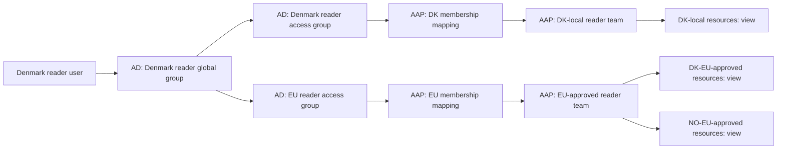

# Demonstrate AD groups mapped to AAP teams

For a short presentation with extra Windows instructions and fewer AAP details,
use the [five-minute walkthrough](active-directory-demo-quickstart.md).

This is a presenter walkthrough for someone who has not used Active Directory
(AD), LDAP or AAP authentication mappings before. Allow 15–20 minutes. It
uses VNC to view the domain controller and a browser to view the dedicated test
AAP. The demonstration reads the existing configuration and runs inert mock
jobs; it does not require editing directory membership or AAP permissions.

For your first presentation, use the Denmark reader walkthrough in sections
2–9. Section 10 adds optional role/region comparisons. The setup reference at
the end is preparation material, not something to walk through on stage.

## 1. Understand the story you are showing

Use this explanation at the start:

> “We maintain people and their regional group memberships in Active Directory.
> When someone signs in, AAP checks AD and puts them into the matching AAP teams.
> Those teams already have permissions on the country's local resources or
> its EU-approved resources, at the person's reader, executor or admin level.”

| Term | Meaning in this demo |
| --- | --- |
| AD | The Windows directory that holds users and groups. |
| Domain controller | The separate Windows Server 2025 VM running AD. |
| LDAP | The protocol AAP uses to find and authenticate directory users and read their groups. |
| LDAPS | LDAP protected by TLS; this demo uses port 636 and certificate verification. |
| AD group | A collection of users, or other groups, maintained in AD. |
| AAP team | A collection of AAP users with assigned AAP resource permissions. |
| Mapping | A rule saying “membership in this AD group gives membership in this AAP team.” |
| OU | An organizational unit: a folder-like container inside AD. |
| DN | A distinguished name: an object's full directory address, including its containers. |
| Country ownership | Which country owns a resource set: DK, NO or NZ. |
| EU-approved access | Clearance allowing DK, NO and HU people to use both countries' approved sets. |

There are four user cohorts—DK, NO, NZ and HU—and five country-owned resource
sets. `DK-local` and `NO-local` allow only their own country's identities.
`DK-EU-approved` and `NO-EU-approved` allow DK, NO and HU identities. `NZ-local`
allows only NZ identities. Hungary has no resource set of its own. EU is a
clearance category, not a resource owner or a separate user cohort; no EU-only
users remain. This is identity-based regional clearance, not detection of a
user's IP address or physical location.

Each set has one inventory, one synthetic credential, one distinct AAP Project
and two inert job templates. The guide uses readable labels such as
`DK-local Inventory`, `DK-local Credential`, Project `DK-local`,
`DK-local Read` and `DK-local Simulate Change`. Use the current-key lookup below
when finding these objects in AAP. All five Projects use the same
public demo Git source. Their visibility demonstrates AAP Project permissions,
not confidentiality of source code in that public repository.

### Readable names and current AAP names

Use `<country>-local` and `<country>-EU-approved` for presentation. The deployed
AAP objects and Ansible resource-set keys currently use the compact spelling
below. For a UI search or an `ad_aap_resume_resource_sets` value, use that current
key. Keep object suffixes and the deployment prefix/role on team names.

| Label in this guide | Current AAP key |
| --- | --- |
| DK-local | `DKlocal` |
| NO-local | `NOlocal` |
| DK-EU-approved | `DKEUapproved` |
| NO-EU-approved | `NOEUapproved` |
| NZ-local | `NZlocal` |
| EU-approved team scope | `EUapproved` |

For example, **DK-local Read** in this guide is currently **DKlocal Read** in
AAP, and the **EU-approved executor** team scope is **EUapproved executor**.

### Complete access matrix

Each cell covers the set's inventory, credential, Project and both templates.
**View** means read only. **Run/use** means view and execute/use; Projects remain
view-only for executors. **Admin** means view, execute/use and administer the scoped
resources. **—** means **no access**. Credential viewing permits metadata access,
not disclosure of its stored password. A resource admin is not an AAP platform
administrator or an AD domain administrator.

#### Denmark

| AD username | DK-local | NO-local | DK-EU-approved | NO-EU-approved | NZ-local |
| --- | --- | --- | --- | --- | --- |
| `geo-dk-reader` | **View** | — | **View** | **View** | — |
| `geo-dk-executor` | **Run/use** | — | **Run/use** | **Run/use** | — |
| `geo-dk-admin` | **Admin** | — | **Admin** | **Admin** | — |

#### Norway

| AD username | DK-local | NO-local | DK-EU-approved | NO-EU-approved | NZ-local |
| --- | --- | --- | --- | --- | --- |
| `geo-no-reader` | — | **View** | **View** | **View** | — |
| `geo-no-executor` | — | **Run/use** | **Run/use** | **Run/use** | — |
| `geo-no-admin` | — | **Admin** | **Admin** | **Admin** | — |

#### New Zealand

| AD username | DK-local | NO-local | DK-EU-approved | NO-EU-approved | NZ-local |
| --- | --- | --- | --- | --- | --- |
| `geo-nz-reader` | — | — | — | — | **View** |
| `geo-nz-executor` | — | — | — | — | **Run/use** |
| `geo-nz-admin` | — | — | — | — | **Admin** |

#### Hungary

| AD username | DK-local | NO-local | DK-EU-approved | NO-EU-approved | NZ-local |
| --- | --- | --- | --- | --- | --- |
| `geo-hu-reader` | — | — | **View** | **View** | — |
| `geo-hu-executor` | — | — | **Run/use** | **Run/use** | — |
| `geo-hu-admin` | — | — | **Admin** | **Admin** | — |

The relationship you will trace is:

AD supplies identity and group membership. Ansible configures the AAP mappings,
teams and permissions. AAP does not import Windows file permissions or other AD
ACLs as permissions on Projects, job templates, credentials or inventories.

If someone asks **“Are the permissions in AD too?”**, answer:

> “AD holds the role groups and who belongs to them. AAP holds the permissions
> on its Projects, inventories, credentials and job templates. Our Ansible
> configuration connects those two: changing a person's AD group changes
> which AAP team's permissions they receive when they authenticate.”

For example, Denmark executor group membership maps to the `DK-local executor`
and `EU-approved executor` teams, with the deployment prefix. Their AAP grants
permit execution of jobs and use of inventories and credentials in `DK-local`,
`DK-EU-approved` and `NO-EU-approved`, plus view-only access to those Projects.
They do not allow `NO-local` or `NZ-local` access. The words `reader`, `executor`
and `admin` in an AD group name do not create resource permissions by themselves.
This is the documented AD-controlled entitlement pattern: directory groups
select the user's AAP teams, whose resource roles supply the effective access.
The normal group mapping requires no custom permission-policy translator.
Creating another AD group alone does not create an AAP team or any resource
permissions: the mapping and desired grants must also be declared in Ansible.
Membership changes within the configured nested groups take effect when the
person authenticates again.

The separate organization is a demo isolation choice. LDAP users do not require
a separate organization merely because their identities come from AD.

### One AD group can select many permissions

An AD group selects an AAP team, and that team can hold several resource roles.
For example, `<prefix>-DL-EU-executor` selects the EU-approved executor team.
Across both approved country sets, it has Project Reader, Inventory Use,
Credential Use and JobTemplate Execute roles: ten object-scoped assignments
covering two Projects, two inventories, two credentials and four templates.
One group therefore selects the entire permission bundle. Another team mapping
can also use the same AD group trigger when separate teams are useful.

## 2. Prepare your screens and demo accounts

1. Open VNC to the **AD domain controller**, rather than a WSUS or application
   server. Sign in with the protected domain-qualified administrator credentials.
   After promotion, use the domain account; a domain controller does not provide
   an ordinary standalone local-user login for this demonstration.
2. Open the **dedicated test AAP** in a browser. Sign in as its local AAP
   administrator. Keep this window open throughout the demonstration.
3. Prepare a separate private/incognito browser window for an AD test user.
   This keeps the administrator and test-user sessions separate.
4. Obtain the Denmark reader account and its password from the protected demo
   configuration before presenting. Also prepare Denmark executor, Denmark
   admin, Hungary executor and New Zealand reader if you want the contrasts below.
5. Check that all five Projects have synced and that **Verify AD AAP Access**
   has a successful run for this five-set model with `ad_verify_ldap_logins: true`.
   A run without that option verifies configured grants, not actual AD login
   and effective access.
   See [validation status](#12-validation-status-and-rehearsal-checks) for the
   completed checks and remaining rehearsal limits.

The tables and sign-in steps use the actual twelve demo usernames. Group and
team examples use `<prefix>` for the deployment's chosen identity prefix;
replace it with the prefix visible in your existing groups and AAP teams.

The protected profile is `vars/active_directory_vault.yml`. The corresponding
`active_directory.users` entries contain `username`, `password`, `region` and
`role`. Retrieve these privately using the existing Vault password source. Do
not project the decrypted profile or reset passwords for the presentation.

## 3. On Windows: find the Denmark reader in AD

1. In the domain controller's VNC window, open **Server Manager**.
2. Select **Tools → Active Directory Users and Computers**. As an alternative,
   press **Win+R**, enter `dsa.msc`, and press Enter.
3. Expand the domain in the left pane.
4. Expand the OU named after `<prefix>`, then select its **DK** OU.
5. Locate the Denmark reader user. Its generated account name ends in
   `-dk-reader`. Double-click it to open **Properties**.
6. Open **Account** and point out **User logon name (pre-Windows 2000)**. That
   short account name is the username to enter into AAP.
7. Open **Member Of**. Locate `<prefix>-GG-DK-reader`.

Expected: the user is directly in its Denmark reader global group. The standard
**Domain Users** membership may also appear. The EU access group need not appear
in this user dialog: **Member Of shows direct memberships, not the full nested
membership chain**.

Say:

> “This is our Denmark read-only identity. Its regional membership is defined
> here in AD. Next we will follow that group to the access groups AAP reads.”

Close the user properties without saving changes.

## 4. On Windows: show why Denmark also receives EU-approved access

`GG` means **global group**, which holds the regional users. `DL` means
**domain-local group**, which is the access group used by the AAP mapping.
Global and domain-local are real AD group scopes. The `GG` and `DL` text in
their names is our readable convention; it does not create permissions itself.
Think **GG = people**, **DL = access role**. The DL group selects an AAP team;
the AAP team holds the actual resource grants.
You do not need to explain Windows group-scope rules in depth during the demo.

1. In the **DK** OU, double-click `<prefix>-GG-DK-reader`.
2. Open **Members**. Show that the Denmark reader user belongs to this group.
3. Open **Member Of**. Show these two parent access groups:

   - `<prefix>-DL-DK-reader`
   - `<prefix>-DL-EU-reader`

4. Close the properties window. Select the **EU** OU.
5. Open `<prefix>-DL-EU-reader`, then its **Members** tab.
6. Show that its members are the global reader groups for **DK**, **NO** and
   **HU**. The New Zealand global reader group is absent.

Say:

> “Denmark, Norway and Hungary readers inherit access to both EU-approved
> country sets. Denmark and Norway keep their own strict-local access;
> neither inherits the other country's strict-local resources. New Zealand
> is separate.”

The same nesting applies separately to executor and admin. Reader membership
does not turn into executor or admin membership.
The same principle gives HU identities only the shared approved sets. HU has
global user groups nested into EU domain-local groups; it needs no `DL-HU`
groups. The existing DL codes stay `DK`, `NO`, `EU` and `NZ` even though the
AAP team names describe the access scopes more explicitly.

## 5. In AAP: show the LDAP connection

Return to the browser window signed in as the AAP administrator.

1. Navigate to **Access Management → Authentication Methods**.
2. Open **`<prefix> Active Directory`**.
3. On its details page, point out that it is enabled and uses **LDAP**.
4. Show that the LDAP server URI starts with `ldaps://` and uses port **636**.
5. Show **LDAP Group Type: NestedActiveDirectoryGroupType**. This is what lets
   AAP follow the group nesting you just showed on Windows.
6. If configuration details require opening **Edit**, inspect them without
   changing anything, then leave with **Cancel**. Keep secret fields masked.

Say:

> “AAP asks this directory to authenticate the user and resolve their groups.
> The connection is encrypted, and AAP follows nested memberships.”

There is no separate Windows domain join of the existing demo servers involved
in this login demonstration.

## 6. In AAP: show the actual AD-to-team rules

1. In the same authentication method, select the **Mapping** tab.
2. Open **DK reader membership**. If the UI only exposes its fields in an edit
   form, inspect that form and leave without saving.
3. Point out these values:

   | Mapping field | Expected value |
   | --- | --- |
   | Mapping type | Team |
   | Organization | `<prefix> Regional Identity Demo` |
   | Team | `<prefix> DK-local reader` |
   | Role | Team Member |
   | Group trigger | The full DN of `<prefix>-DL-DK-reader`, stored in lowercase |
   | Revoke | Enabled |

4. Explain that the long group value is the AD group's address, not a second
   AAP team name. It identifies the access group shown on Windows.
5. Return to the mapping list and open **EU reader membership**. Show that it
   targets `<prefix> EU-approved reader` and matches the EU reader access group's DN.
6. Point out that there are twelve team rules: four access scopes times three
   roles. `EU-approved` covers both approved country resource sets; it is not a
   fifth country or a separate user cohort.
   The separate **Regional demo login** and **Regional demo organization** rules
   admit eligible identities and give them organization membership.

To show the same full address on Windows, select **View → Advanced Features**
in Active Directory Users and Computers. In the **DK** OU, open
`<prefix>-DL-DK-reader` directly, select **Attribute Editor**, locate
**distinguishedName**, and inspect its full value. Compare it with the AAP trigger;
letter case differs because the trigger is normalized to lowercase. Close
the dialogs without changing the attribute.

Say:

> “This is the bridge between the two systems: membership in this AD access
> group becomes membership in this AAP team when the user authenticates.”

The mapping's **Team Member** role means membership of the AAP team. It is not
the reader/executor/admin resource role. The team name describes its purpose;
its separate resource assignments enforce that purpose.

## 7. In AAP: show what the reader team is permitted to do

1. Navigate to **Access Management → Teams**.
2. Search for and open `<prefix> DK-local reader`.
3. Open the **Roles** tab and inspect its resource assignments. If the UI offers
   a service filter, select **Automation Execution**.
4. Show the five assignments: Project `DK-local`, `DK-local Inventory`,
   `DK-local Credential`, `DK-local Read` and `DK-local Simulate Change`.
5. Point out the custom reader roles. They contain view permissions only.
6. Open `<prefix> EU-approved reader`. Show its ten assignments: the five
   resources in each of `DK-EU-approved` and `NO-EU-approved`.

Say:

> “AD determines which team the person joins. These AAP assignments determine
> what that team can see and do. The grants are scoped to particular resources.”

Each resource set has one Project, one inventory, one synthetic credential and
two inert job templates, **Read** and **Simulate Change**. A credential reader
can view its metadata; this does not reveal its stored password. Executors have
inventory/credential Use, template Execute and view-only Project access. Admin
teams receive management roles on their permitted objects only.

## 8. Log in as the AD user and show the membership result

1. In the private browser window, open the same test AAP URL.
2. Sign in with the **Denmark reader's AD username and password**, not the
   local AAP administrator account. Use the short account name found in step 3.
3. Confirm that the signed-in identity is the Denmark reader.
4. Return to the administrator window. Navigate to **Access Management → Users**,
   find that exact account, and open its **Teams** tab.
5. Show that the user belongs to exactly the two regional teams:

   - `<prefix> DK-local reader`
   - `<prefix> EU-approved reader`

6. Alternatively, open each of those teams and its **Users** tab to show the
   same membership from the team's perspective.

Say:

> “We signed in with an AD identity. The mapping put it in the DK-local reader
> and EU-approved reader teams, following the memberships we saw in AD.”

The account may already exist in AAP because rehearsal or automated verification
has logged it in. Do not claim that you just created it. The evidence is the
matching AD group chain, mapping rules, authenticated identity and team result.
The teams themselves were created by Ansible before user login; their existence
alone is not evidence that LDAP mapping works.

## 9. As the reader: demonstrate the access boundaries

Perform these actions in the **private reader window**, not the administrator
window.

1. Open **Automation Execution → Infrastructure → Inventories**. Show
   `DK-local Inventory`, `DK-EU-approved Inventory` and `NO-EU-approved Inventory`.
2. Show that `NO-local Inventory` and `NZ-local Inventory` are absent.
3. Open **Automation Execution → Templates**. Show the six mock templates
   belonging to those three allowed sets. As a reader, the user must not be
   able to launch them.
4. Open **Automation Execution → Infrastructure → Credentials**. Show the
   corresponding three mock credentials' metadata without revealing secrets.
5. Open **Automation Execution → Projects**. Show `DK-local`, `DK-EU-approved`
   and `NO-EU-approved`; `NO-local` and `NZ-local` must be absent.
6. Point out that editing these resources is unavailable to the reader. The
   browser may hide forbidden actions instead of displaying an error dialog.

Say:

> “This person can inspect Denmark's strict-local automation and both countries'
> EU-approved automation. They cannot run jobs, change configuration, or see
> Norway's strict-local resources or New Zealand's resources.”

If your UI navigation is collapsed, expand **Automation Execution** first.
Labels and button placement can vary with the installed UI build; the object
names and access outcomes above are the checks that matter.

## 10. Show Hungary, executor, admin and New Zealand contrasts

Sign out of the private window between accounts; keep the administrator window
unchanged. Use the same AD → mapping → team explanation for each identity.

| AD identity | Expected AAP teams | What to demonstrate |
| --- | --- | --- |
| Denmark executor | DK-local executor, EU-approved executor | Launch `DK-local Read` and wait for **Successful**. It can also run both approved sets, but cannot edit inventory configuration. |
| Denmark admin | DK-local admin, EU-approved admin | On an allowed resource show **Edit**, then **Cancel**. NO-local and NZ-local remain absent. |
| Norway reader | NO-local reader, EU-approved reader | NO-local and both approved sets visible; DK-local and NZ-local absent. |
| Hungary executor | EU-approved executor only | Show only DK-EU-approved and NO-EU-approved. Launch `NO-EU-approved Simulate Change` and wait for **Successful**; both strict-local sets and NZ-local remain absent. |
| New Zealand reader | NZ-local reader only | NZ-local visible; all four DK/NO sets absent. |

The team names in this table carry the deployment prefix. No standalone EU user
is needed: the shared team gets its users through DK, NO and HU nested groups.
An admin in this table administers the allowed demo resources, not AAP itself
or the Windows domain.

The **Read** and **Simulate Change** templates run
[`mock_regional_job.yml`](../mock_regional_job.yml). Both are demonstrations
against a local mock host, with fixed regional inputs and synthetic credentials.
**Simulate Change** only reports a simulated changed result. Neither operation
patches a server or changes infrastructure. Inspect the job's
output and final status rather than stopping at “launch accepted.”

Describe New Zealand as an **external region with separate access in this demo**.
Its identities live in the same demonstration AD forest. No separate forest,
trust relationship or automatic EU entitlement has been deployed.

## 11. Close with the automation evidence

1. In the administrator window, find the template ending **Verify AD AAP
   Access**. Open a successful run whose inputs enable `ad_verify_ldap_logins`.
2. Show the final **Report non-sensitive verification counts** output.
3. Compare the result with this model's expected counts: **4 user cohorts,
   5 resource sets, 12 teams, 75 scoped team grants, 12 real LDAP logins,
   360 primary resource-read/launch checks and 36 completed mock jobs**. Both
   template operations are exercised; description PATCH and exact-list checks
   are additional. Forbidden access and reader launches must be rejected.
   Use a successful run of the revised model, not a historical run with fewer
   resources. See the validation status below before presenting it as proof.
4. If desired, show the deployment workflow's eight AD stages. Explain that
   Ansible created the directory, trust, identities, maps and permissions.
   Opening the workflow does not require launching it.

Suggested closing words:

> “The identity administrator manages regional membership in AD. On login, AAP
> maps those groups to teams. Ansible maintains the teams' scoped automation
> permissions and verifies both permitted and forbidden access.”

## 12. Validation status and rehearsal checks

Live validation of this five-set model **passed on 2026-10-23**: **12 teams,
75 scoped grants, 12 real LDAP logins, 360 primary resource-read/launch checks
and 36 successful mock jobs**. Both template operations executed their tasks on
localhost. Additional checks passed: 108 admin-only description PATCH checks,
48 exact resource-list checks and 24 gateway/controller team-membership checks.
These results cover HU membership, strict-local and NZ isolation, shared
approved access and role boundaries. All three EU-only accounts are absent
from both gateway and controller, and the legacy shared Project is removed.

Earlier runs stopped at first-login controller access for Norway identities.
Inspection found a gateway identity and correct memberships before a controller
account had been provisioned. The verifier now reads each user's own identity
on both services before checking permissions, then retains its bounded wait for
expected access. No permission grants were broadened during diagnosis.

The automated checks do not establish that this VNC/browser presenter script
has been rehearsed end to end, or that the complete combined infrastructure
workflow has been run from scratch. Rehearse the selected accounts and screens
before presenting.

| Symptom | Check before presenting |
| --- | --- |
| No AD console in VNC | Confirm that this is the domain controller. The deployment installs AD management tools; try `dsa.msc`. |
| Cannot find groups | Expand the prefix OU and its DK/NO/NZ/HU user OUs; the shared access groups are in EU. HU has global groups only. |
| EU-approved access absent in a user's AD Member Of tab | Inspect the user's global group's **Member Of** or the EU access group's **Members**; nested membership is not listed as direct membership on the user. |
| LDAP login fails | Check the selected test AAP, exact short username, enabled authenticator, domain time, DNS, LDAPS certificate and gateway trust. Use the existing inspection and trust templates. |
| Login works but teams are missing | Inspect both relevant mapping rules, their full lowercase group DNs and the nested group type. Reauthenticate after configuration or membership changes. |
| Teams are present but a resource is missing | Inspect that team's resource Roles in the administrator window and gateway/controller convergence. Run the verifier; do not add broad roles to make the demo pass. |
| Reader can launch, or a forbidden set is visible | Compare with the full matrix, then stop that part of the demonstration and investigate any permission failure. Both approved country sets are intentionally visible to DK/NO/HU. |
| Inventory list shows Disabled | This is the inventory-source synchronization status: no source is configured. The static mock inventory and its enabled local host remain usable for jobs. |
| An old authenticated session still has access | Mapping is evaluated during authentication; refreshing a page alone is not a membership-revocation test. |

This walkthrough covers granting access, automatic first login and role/country
isolation. A separate removal-and-restoration demonstration is outside the
requested scope.

## 13. Setup reference for the existing Ansible automation

This section is for preparing the demo, rather than narration during it.
Connection details, privileged account credentials, keys and passwords remain
in Vault or protected AAP credentials. The tables above list the requested demo
usernames for presentation.

1. Use the existing Server 2025 image, hypervisor inventory and an execution
   environment compatible with the pinned
   [`collections/requirements.yml`](../collections/requirements.yml). Keep a
   separate one-host Windows inventory for the new domain controller; its
   management connection is WinRM HTTPS on port 5986.
2. Reuse the approved encrypted `vars/active_directory_vault.yml` for this
   deployment. For a genuinely new environment,
   [`initialize_active_directory_profile.yml`](../initialize_active_directory_profile.yml)
   generates users, group nesting, passwords and dedicated LDAPS PKI from a
   protected `ad_profile_seed`, `ad_profile_encrypted_output` and
   `ad_profile_vault_password_file`. It refuses an existing output. Preserve the
   resulting profile and matching private backup rather than regenerating them
   on reruns.
3. Populate the **Windows AD AAP Target** credential for the selected test AAP.
   It contains the target URL, administrator password, trusted public CA bundle,
   SSH account/password, previously verified SSH host keys and installation
   service account. The CA is injected as a private file. Attach that credential
   and the playbook Vault credential to target-configuration stages. Attach the
   hypervisor SSH plus Vault credentials to hypervisor stages, and Windows
   machine plus Vault credentials to Windows stages.
4. For a fresh environment, use the AD branch in the existing Windows workflow,
   in the order shown below. Existing Windows nodes are preserved. The encrypted
   Windows CaC repository includes this branch and its target credential
   definition; the AutoDeploy Windows importer populates the credential for the
   receiving AAP. Importing definitions does not run the deployment or enable LDAP.

   | Order | Template suffix | Playbook | Required result |
   | --- | --- | --- | --- |
   | 1 | Reserve AD Address | [`configure_active_directory_address.yml`](../configure_active_directory_address.yml) | Unambiguous DHCP reservation and matching LDAPS DNS name, with `ad_address_reservation_before_create: true`. |
   | 2 | Create AD VM | [`create_active_directory_vm.yml`](../create_active_directory_vm.yml) | A new, independent Server 2025 VM; an existing VM/disk is refused. |
   | 3 | Prepare and Update AD Guest | [`prepare_active_directory_guest.yml`](../prepare_active_directory_guest.yml) | `ad_direct_microsoft_updates_approved: true`; zero remaining applicable Server updates and no pending reboot. |
   | 4 | Deploy Active Directory | [`deploy_active_directory.yml`](../deploy_active_directory.yml) | AD DS/DNS ready, synchronized domain clock, 12 users and 24 role groups with verified nesting. |
   | 5 | Configure AD LDAPS | [`configure_active_directory_ldaps.yml`](../configure_active_directory_ldaps.yml) | Correct certificate, hostname/chain verification and completed required restart. |
   | 6 | Configure AD Gateway Trust | [`configure_aap_ad_trust.yml`](../configure_aap_ad_trust.yml) | `ad_trust_verify_ldaps: true` and `ad_require_target_credential: true`; actual gateway-runtime LDAPS validation passes. |
   | 7 | Configure AD AAP Regions | [`configure_aap_ad_regions.yml`](../configure_aap_ad_regions.yml) | `ad_aap_configure_authentication: true` and `ad_require_target_credential: true`; all scoped resources and ordered LDAP maps configured. |
   | 8 | Verify AD AAP Access | [`verify_aap_ad_regions.yml`](../verify_aap_ad_regions.yml) | `ad_verify_ldap_logins: true` and `ad_require_target_credential: true`; full positive/negative access verification passes. |

5. The trust stages publish `ad_ldaps_ready` and `ad_gateway_trust_ready` for
   later workflow stages. When retrying LDAP configuration separately, supply
   these readiness flags only after checking successful trust results. If the
   resources already exist, `ad_aap_authentication_only: true` verifies all 75
   existing grants before resuming authentication configuration.
6. For the existing deployment's regional redesign, reconcile identities with
   `ad_identities_only: true`, configure the scoped AAP resources and mappings,
   then run the LDAP access verifier. Retire obsolete EU-only identities and
   old generic regional resources through the guarded owned-object cleanup;
   preserve the existing controller and unrelated objects. For a failed stage,
   retry that stage rather than launching fresh VM creation over the controller.
   If all five sets already have their final names and fixed links, a focused
   `ad_aap_resume_resource_sets` list can retry only selected resource sets.
   This mode first requires complete owned-object/reference inspection, skips
   successful Project/team preparation, and still performs cleanup and LDAP
   configuration. Grant and mapping calls have bounded retries for transient
   collection connection-manager startup failures. Run the full verifier after
   any resume; a partial grant count is not completed validation.
   The guest inspector is
   [`inspect_active_directory_guest.yml`](../inspect_active_directory_guest.yml);
   use `ad_inspect_domain_auth: true` after promotion.
7. Keep the encrypted profile backup in the private Windows CaC repository
   consistent with the profile loaded by the public playbooks. The capture's
   `cac` Vault identity and the playbook-profile Vault password are separate.

### Adding people or another country

For another person using an existing role, create an enabled AD user with a
valid password **inside the demo OU searched by LDAP**, then add the user to
the appropriate country global group, such as `<prefix>-GG-DK-reader`.
The existing nesting supplies both local and EU-approved reader membership.
The person signs in to AAP with the AD account; first login creates the AAP
identity and applies the existing team maps. No manual AAP user, team or grant
is needed. AD changes are evaluated on authentication, so sign out and sign
in again when demonstrating a changed membership.

#### Create a new AD user and show automatic AAP access

This optional exercise creates a temporary user. The automated access verifier
covers the twelve generated demo identities; check this extra user's access
manually during the demonstration.

1. In the AAP administrator window, search **Access Management → Users** for a
   fresh example name such as `demo-new-reader`. Confirm it does not exist.
2. On the domain controller, press **Win+R**, enter `dsa.msc`, and expand the
   domain → deployment-prefix OU → **DK**.
3. Right-click **DK → New → User**. Enter a display name and use
   `demo-new-reader` as the short user logon name, then select **Next**.
4. Choose a password accepted by AD, uncheck **User must change password at next
   logon**, and keep the account enabled. The simple-password exception applies
   only to the twelve generated demo users; this new user needs a normal AD
   password. AAP cannot complete an AD password-change-at-first-login prompt.
   Select **Finish** after entering these password/account settings.
5. Open the new user → **Member Of → Add**. Enter
   `<prefix>-GG-DK-reader`, select **Check Names → OK → Apply**.
6. Open a private browser window on the dedicated test AAP. Sign in with the
   new short username and its AD password. No AAP user creation, configuration
   JT or directory synchronization is needed.
7. Show DK-local and both EU-approved resource sets. NO-local and NZ-local are
   absent. The reader can view resources but cannot launch their jobs or edit
   their configuration. Then refresh the administrator's user list: the new
   account now exists and has DK-local reader and EU-approved reader teams.
8. Keep the account for further demonstrations, or delete the temporary AD user
   and its AAP record to repeat the first-login exercise from a clean starting
   point. Identity setup reruns preserve additional members and their memberships.

For an executor demonstration, use the matching country executor global group
instead of its reader group. The existing mapping then selects executor teams.

For a new country receiving only existing EU-approved access, its matching-role
global groups can nest into the existing EU domain-local groups. Those access
groups already have AAP mappings. For a new country with its own local
resources, extend the declared directory model, protected profile, resource
sets and acceptance matrix, then run **Deploy Active Directory** in
identity-only mode, **Configure AD AAP Regions**, and **Verify AD AAP Access**.
The configuration template creates the declared teams, grants and LDAP maps
together. There is no separate add-country survey template. The supplied model
and verifier cover the four demo countries and twelve generated users. Identity
reconciliation preserves additional users and nested groups added by AD
administrators, while still enforcing the generated users' declared memberships
and country/role boundaries.

The opt-in `ad_verify_additional_members: true` identity-only run creates an
additional user and global group, reconciles twice, verifies preserved direct
and nested access, and cleans up its test objects. It requires
`ad_identities_only: true` without password resets. Additional manual users keep
their passwords and use their normal AD password policy.
This native Windows test passed, including an unchanged second reconciliation
and verified cleanup. The following full AAP regression also passed all twelve
logins, 75 grants, 360 primary access checks and 36 completed mock jobs.

The Microsoft patch check reports the Windows 11-only KB5007651 Security UI
offer separately on Server 2025. It does not exclude applicable Server updates
or Defender antivirus updates. See the [README](../README.md#active-directory-extension)
for the product-applicability explanation and detailed recovery options.

## Reference: all twelve team mappings

Each row maps an access group to **Team Member** in the named AAP team. All
teams belong to `<prefix> Regional Identity Demo`. The actual trigger uses the
group's full lowercase DN, not just the short name in this table.

| AD access group | AAP team | Resource sets | Permissions |
| --- | --- | --- | --- |
| `<prefix>-DL-DK-reader` | `<prefix> DK-local reader` | DK-local | View only |
| `<prefix>-DL-DK-executor` | `<prefix> DK-local executor` | DK-local | Run/use; Project view only |
| `<prefix>-DL-DK-admin` | `<prefix> DK-local admin` | DK-local | Administer assigned resources |
| `<prefix>-DL-NO-reader` | `<prefix> NO-local reader` | NO-local | View only |
| `<prefix>-DL-NO-executor` | `<prefix> NO-local executor` | NO-local | Run/use; Project view only |
| `<prefix>-DL-NO-admin` | `<prefix> NO-local admin` | NO-local | Administer assigned resources |
| `<prefix>-DL-EU-reader` | `<prefix> EU-approved reader` | DK-EU-approved, NO-EU-approved | View only |
| `<prefix>-DL-EU-executor` | `<prefix> EU-approved executor` | DK-EU-approved, NO-EU-approved | Run/use; Project view only |
| `<prefix>-DL-EU-admin` | `<prefix> EU-approved admin` | DK-EU-approved, NO-EU-approved | Administer assigned resources |
| `<prefix>-DL-NZ-reader` | `<prefix> NZ-local reader` | NZ-local | View only |
| `<prefix>-DL-NZ-executor` | `<prefix> NZ-local executor` | NZ-local | Run/use; Project view only |
| `<prefix>-DL-NZ-admin` | `<prefix> NZ-local admin` | NZ-local | Administer assigned resources |

Each resource set contains one Project, one inventory, one synthetic credential
and both mock Job Templates. The table above means these exact object roles:

| Permission level | Project | Inventory | Credential | Both Job Templates |
| --- | --- | --- | --- | --- |
| View only | `<prefix> project Reader` | `<prefix> inventory Reader` | `<prefix> credential Reader` | `<prefix> jobtemplate Reader` |
| Run/use | `<prefix> project Reader` | Inventory Use | Credential Use | JobTemplate Execute |
| Administer assigned resources | Project Admin | Inventory Admin | Credential Admin | JobTemplate Admin |

Each custom Reader definition contains only its resource's `view` permission.
Credential viewing exposes metadata, with its password masked. These rows grant
no organization, platform or AD administrator privileges. The JT applies this
declared table; LDAP reads actual nested user membership during authentication.

HU's three global groups join the matching EU domain-local groups above.
There are no HU-specific AAP teams or domain-local groups. `EU-approved` team
grants cover both approved country sets; strict-local grants remain on their
separate local teams.

Configuration lives in
[`tasks/configure_aap_ad_authentication.yml`](../tasks/configure_aap_ad_authentication.yml),
resource grants in
[`tasks/configure_aap_ad_region.yml`](../tasks/configure_aap_ad_region.yml),
and the group graph in
[`assets/active-directory-model.py`](../assets/active-directory-model.py).
The AAP navigation and mapping behavior are described in Red Hat's
[AAP 2.7 mapping documentation](https://docs.redhat.com/en/documentation/red_hat_ansible_automation_platform/2.7/secure-assembly_gw_mapping).
