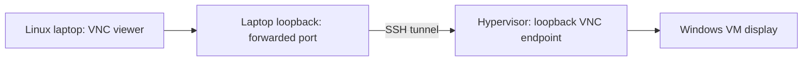

# Windows remote access suggestion

Use the existing hypervisor VNC consoles through SSH from a Linux laptop to
show the Windows guests and verify application or OS upgrades during a demo.
This document is a suggestion and connection guide, not a new access service or
an implemented Windows OS patching procedure.

## Recommended route

The [VM deployment playbook](01-win-vm-setup.yml) configures VNC with
`--graphics vnc,listen=127.0.0.1`. Console traffic reaches the guest display
through the hypervisor independently of the guest's network configuration.



Use the laptop's existing authorized SSH route and identity. An SSH alias defined
in the automation workspace must also be defined on the laptop, or replaced with
the laptop's own SSH target. If that route uses a jump host, use its existing
`ProxyJump` configuration or `-J YOUR_EXISTING_BASTION_ALIAS`.

The laptop needs an installed VNC viewer, such as TigerVNC, Remmina or
remote-viewer. A full Windows desktop demonstration also requires Desktop
Experience in the guest image; confirm this before the presentation.

## Discover the active console

Replace the placeholders below with the intended existing hypervisor SSH alias
and Windows VM domain name. These commands only inspect libvirt:

```bash
demo_hypervisor_ssh='YOUR_HYPERVISOR_SSH_ALIAS'
demo_windows_vm='YOUR_WINDOWS_VM_NAME'

ssh "$demo_hypervisor_ssh" \
  virsh --readonly --connect qemu:///system list --all --name

ssh "$demo_hypervisor_ssh" \
  virsh --readonly --connect qemu:///system domstate "$demo_windows_vm"

ssh "$demo_hypervisor_ssh" \
  virsh --readonly --connect qemu:///system domdisplay --type vnc "$demo_windows_vm"
```

A shut-off VM has no active console endpoint. Start the intended existing VM
through its normal authorized management process before resolving the endpoint.
For a VNC display number `N`, the TCP port is `5900 + N`; for example, display
`:2` corresponds to TCP port `5902`. Recheck after a restart because ports are
assigned automatically. Keep live VM names and resolved addresses in local
configuration, outside this repository.

## Open the SSH tunnel

In the same laptop terminal, set the remote TCP port obtained above. The local
port below is an example chosen for the laptop, not a deployed environment value.

```bash
demo_remote_vnc_port='YOUR_RESOLVED_VNC_TCP_PORT'
demo_local_vnc_port=15922

ssh -N -o ExitOnForwardFailure=yes \
  -L "127.0.0.1:${demo_local_vnc_port}:127.0.0.1:${demo_remote_vnc_port}" \
  "$demo_hypervisor_ssh"
```

Keep that terminal open. The viewer connects to laptop loopback; SSH forwards
the connection to the hypervisor's loopback VNC endpoint. The existing SSH
service must permit this forwarding. See the [OpenSSH manual](https://man.openbsd.org/ssh.1)
for `-L`, `-N` and `-J`.

In a second laptop terminal, connect with an installed viewer. For TigerVNC,
double colon specifies a literal TCP port:

```bash
vncviewer 127.0.0.1::15922
```

Alternatively, open a Remmina VNC profile for `127.0.0.1:15922`, or use:

```bash
remote-viewer vnc://127.0.0.1:15922
```

The example viewer commands assume the example local port `15922`. Use the
viewer menu to send Ctrl+Alt+Delete when Windows requests it, and sign in with
an existing authorized Windows account. For a second VM, resolve its own remote
port and choose a different local port. Close the viewer and stop the SSH tunnel
with Ctrl+C after the demonstration.

Viewer references: [TigerVNC connection syntax](https://tigervnc.org/doc/vncviewer.html)
and [remote-viewer documentation](https://gitlab.com/virt-viewer/virt-viewer/-/raw/master/man/remote-viewer.pod).

## Evidence to show during the demonstration

| Change | Evidence on the Windows guest |
| --- | --- |
| Windows cumulative update | Run `winver` before and after each stage; compare the resulting OS build with the expected target. Record `CurrentBuildNumber` and `UBR` when collecting detailed evidence. |
| Windows update installation | Event Viewer: Windows Logs → System, filtered to source `WindowsUpdateClient`; correlate successful installation events with the selected KBs. |
| 7-Zip upgrade | Show Programs and Features' version column or 7-Zip's Help → About dialog before and after. |
| Git upgrade | Show Programs and Features and run `git --version` in Git Bash. The vendor version and Chocolatey package revision need not have identical strings. |

Microsoft distinguishes Settings' Windows Update orchestrator history from
updates installed through Windows Update Agent APIs. Settings history can omit
Ansible/WUA installations, so use the resulting build and installation events
as the main evidence. See [Windows Update Agent API](https://learn.microsoft.com/en-us/windows/win32/wua_sdk/portal-client).

Keep environment-specific screenshots, recordings and diagnostic output outside
Git. Use approved protected storage for evidence that contains account or host
details.

## Suggested patch levels X and X+1

Use two named, pinned OS baselines to make a repeatable before-and-after demo.
Define separate KBs, update identities/revisions and expected builds for Server
2022 and Server 2025.

| Stage | Selection | Verification |
| --- | --- | --- |
| Starting image | A known image older than both target baselines | Capture its initial build and applicable-update assessment. |
| Level X | An explicitly selected older monthly cumulative update, with its required prerequisites | Approve the selected baseline for the intended demo clients, install, reboot as required, and verify its target build. |
| Level X+1 | A newer cumulative update and its required prerequisites | Approve the next baseline, install, reboot as required, and verify the newer target build. |

Ansible's `win_updates` supports explicit KB/title allowlists through
`accept_list`, category selection and scan-only `state: searched`. Date selection
can be resolved in WSUS first and frozen into exact update selections; the module
does not expose a native date-cutoff parameter. See [win_updates documentation](https://docs.ansible.com/projects/ansible/latest/collections/ansible/windows/win_updates_module.html).

Date fields have different meanings:

| WSUS field | Meaning |
| --- | --- |
| `CreationDate` | When that revision of the update metadata was authored, in UTC; this is not necessarily the original patch release date. |
| `ArrivalDate` | When that revision's metadata finished downloading to that WSUS server, in UTC. |

WSUS `UpdateScope` supports maximum dates such as `ToCreationDate`. Use the
chosen release history and exact KBs to define the intended patch level, and
preserve that selection for later runs. References: [CreationDate](https://learn.microsoft.com/en-us/previous-versions/windows/desktop/ms751979(v=vs.85)),
[ArrivalDate](https://learn.microsoft.com/en-us/previous-versions/windows/desktop/ms751977(v=vs.85))
and [UpdateScope date filters](https://learn.microsoft.com/en-us/previous-versions/windows/desktop/aa354556(v=vs.85)).

Monthly OS updates are cumulative: stage complete cumulative updates rather
than trying to install selected fixes from inside one package. Server 2025
checkpoint prerequisites must be included where required. See [Microsoft's
checkpoint cumulative update guidance](https://learn.microsoft.com/en-us/windows/deployment/update/catalog-checkpoint-cumulative-updates).

The current external sync selects recent, non-superseded updates and includes
file-bearing prerequisites. The older X baseline may need explicit selection,
download and retention alongside X+1. Audit available binaries, approvals and
actual client applicability before choosing the final baselines. Component-based
waves, such as Windows followed by .NET, are another demonstration option, but
each needs its own version evidence.

Installed build and hotfix assessment is implemented in
[assess_windows_patch_level.yml](assess_windows_patch_level.yml) and its dedicated
Job Template. Client applicability scans, internal approval and OS installation
remain proposed stages in [TODO.md](TODO.md). Application baseline deployment
and upgrades already have separate playbooks and Job Templates.

## Validation status and alternatives

The 2026-10-20 read-only inspection verified the deployment's loopback VNC
configuration, working read-only system-libvirt access and an active Windows
console endpoint. Resolve individual VM states and ports again before a demo.
The end-to-end laptop connection, its SSH forwarding permissions and the guests'
Desktop Experience installation remain unverified.

The repository does not configure RDP. RDP would require a verified route to the
guest and its service, authentication and firewall settings. No existing
browser-based console deployment was identified. These alternatives are outside
the verified VNC route described here.
